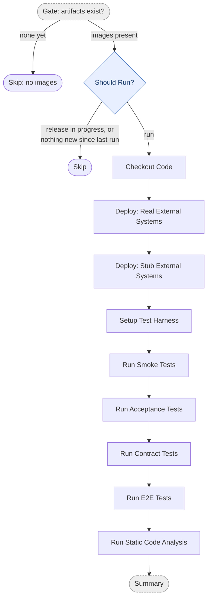
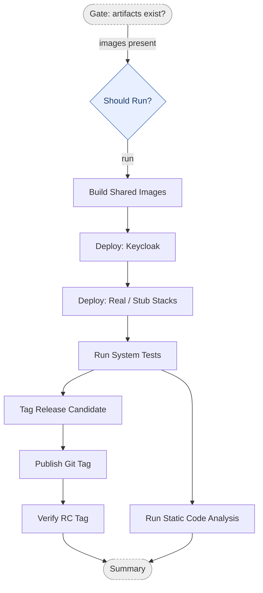

# Acceptance Stage

Every flavor (`<architecture>-<language>`, e.g. `multitier-java`) runs acceptance on two tracks:

| Track | Workflow | Runs | Deploys to | Tags an RC? |
|---|---|---|---|---|
| **Docker Compose gate**, latest suites | `<flavor>-acceptance-stage-docker-compose.yml` | Every prerelease pipeline run, plus hourly | Docker Compose on the GitHub runner, thrown away after the run | No |
| **Docker Compose gate**, legacy suites | `<flavor>-acceptance-stage-docker-compose-legacy.yml` | Every prerelease pipeline run | Docker Compose on the GitHub runner | No |
| **Cloud acceptance stage**, latest suites | `<flavor>-acceptance-stage.yml` | Manual (`workflow_dispatch`) on a commit that passed both gates | Cloud Run, a production-like environment | **Yes**: it owns `<flavor>-v<x.y.z>-rc.N` |

The gates are free and fast, so a red commit never reaches the cloud. The cloud stage is the real
acceptance stage: it is the only thing that creates release candidates, and QA deploys only those.
It is manual to keep the cloud at $0 in normal use; its `schedule:` cron sits in the file commented
out for anyone who wants it automatic (see [the cost model](../../terraform/README.md#cost)).

All three are thin callers. The Docker Compose gates call `_acceptance-stage-docker-compose.yml`
with `suite-set: latest` or `legacy`; the cloud stage calls `_acceptance-stage.yml`. Everything
per-flavor (compose directory, ports, gh-optivem config, test harness, Cloud Run names, VERSION
file) is derived from `architecture`, `language` and `test-language`.

Because RCs only appear when the cloud stage is dispatched, the prerelease pipeline
(`_prerelease-pipeline.yml`) stops at the gates: QA, sign-off and production are dispatched by
hand afterwards (see [QA and production stages](qa-and-prod-stages.md)).

## Before acceptance: the local stage

The prerelease pipeline's `local` job is "Docker Compose, like on your machine". It runs the same
compile, lint, unit and component checks as the commit stages, then `gh optivem system start`
(real and stub stacks), and one sample test per suite for latest and, unless skipped, legacy. It is
the same thing a developer runs locally before committing (see the repo `CLAUDE.md`).

## Legacy is a separate, deletable workflow

The legacy suites (`modNN-*`) live in their own caller, `<flavor>-acceptance-stage-docker-compose-legacy.yml`,
and their own pipeline job, `acceptance-stage-legacy`. A project that doesn't need them deletes
that one file and that one job, and nothing else changes. Legacy never runs on the cloud: it would
need its own Cloud Run services and databases, and it gates nothing the latest suites don't.

## Docker Compose gate

- **Gate: artifacts exist?** and **Should Run?** are orchestration gates, not pipeline stages. The first skips when the commit stage has not published every image yet. The second skips when the version is already released (latest only), or, on an unpinned run, when there are no new images since the last run *and* no test or workflow changes since the last RC tag. A pinned run (`commit-sha`) always runs.
- **Deploy** brings the system up twice on the runner, once wired to real external systems and once to stubs, each followed by a wait-for-endpoints health check.
- **Run … Tests** is the full system suite split by category (smoke, acceptance, contract, e2e), one step per suite so a failure names its suite. The legacy caller runs the `modNN-*` suites instead.
- **Run Static Code Analysis** (Sonar) runs for latest only.
- Nothing is tagged: the gate reports the image tag it tested (`sha-<sha>` or `latest`).

### Diagram ↔ YAML mapping (`_acceptance-stage-docker-compose.yml`)

Every box carries a `# === <Box> ===` anchor in the YAML: whole-job boxes anchor at the job key,
the in-`run` boxes at the first step of their group. The `summary` job is orchestration.

| Diagram box | YAML steps / job |
|---|---|
| Gate: artifacts exist? | `preflight` job: Check Inputs Are Supported, Expand Image URLs, Check Container Packages Exist |
| Should Run? | `check` job: validate env vars, checkout, read base version, check release tag exists, GHCR login, resolve image digests, get last run, check artifacts changed, detect test changes, Evaluate Run Gate |
| Checkout Code | Checkout Repository, Docker Hub login, GHCR login |
| Deploy: Real External Systems | Simulate Deployment (Real External Systems), Wait for Systems |
| Deploy: Stub External Systems | Simulate Deployment (Stub External Systems), Wait for Systems |
| Setup Test Harness | toolchain setup (per test language), Cache Playwright, Compile System Tests (.NET), Install Playwright Browser (legacy), Install gh-optivem CLI, Setup Test Harness |
| Run Smoke / Acceptance / Contract / E2E Tests | one step per suite; legacy: the `modNN-*` steps |
| Run Static Code Analysis | `sonar` job (latest only) |

## Cloud acceptance stage

- **Build Shared Images** builds Keycloak, db-migrate, simulators and stubs into public GHCR (`ghcr.io/<owner>/<repo>/shop-*`), only when their tree-hash tag is missing, and checks that every image Cloud Run will pull is anonymously pullable.
- **Deploy: Keycloak** deploys the one Keycloak every flavor and stage shares, and only redeploys when something changed. **Deploy: Real / Stub Stacks** deploys, per stack, the external systems, runs the database migrations (Neon) and deploys the system (monolith) or backend and frontend (multitier), straight from the tested GHCR digests.
- **Run System Tests** runs the same latest suites as the gate, in the flavor's test language, against the Cloud Run URLs. When the `ACC_DOMAIN` / `E2E_DOMAIN` repo variables are set, multitier-java's UI tests use its custom domains instead (see [Environments](../environments.md)).
- **Tag Release Candidate**, **Publish Git Tag** and **Verify RC Tag** run on `main` only: the tested images get the `<flavor>-v<x.y.z>-rc.N` tag, the git tag is published, and the run fails if the tested SHA ends up with no RC tag.

### Diagram ↔ YAML mapping (`_acceptance-stage.yml`)

| Diagram box | YAML steps / job |
|---|---|
| Gate: artifacts exist? | `preflight` job |
| Should Run? | `check` job (as the gate's, plus Check Commit on Main) |
| Build Shared Images | `shared-images` job (`.github/actions/build-shared-images`) |
| Deploy: Keycloak | `deploy-keycloak` job (`.github/actions/deploy-keycloak`) |
| Deploy: Real / Stub Stacks | `deploy-stack` job (matrix `real`, `stub`) |
| Run System Tests | `run` job: Resolve System URLs, checkout, harness setup, Point systems.yaml at the Deployed Stack, one step per suite |
| Tag Release Candidate | `run` job: Read Base System Version, Compose Prerelease Version, Tag Docker Images for Prerelease |
| Publish Git Tag | `publish-tag` job |
| Verify RC Tag | `verify-rc-tag` job |
| Run Static Code Analysis | `sonar` job |

Workflows: `monolith-{dotnet,java,typescript}-acceptance-stage{,-docker-compose,-docker-compose-legacy}.yml`,
`multitier-{dotnet,java,typescript}-acceptance-stage{,-docker-compose,-docker-compose-legacy}.yml`.
