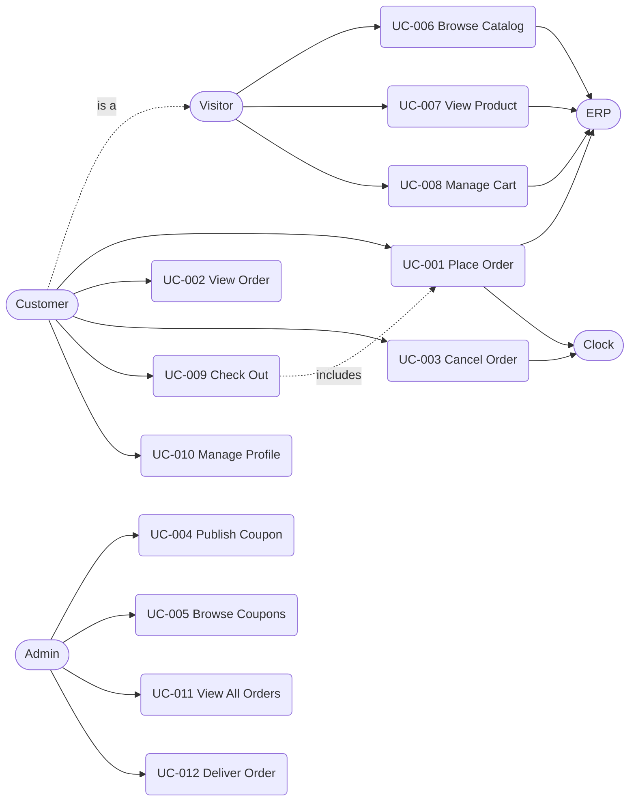

# MyShop — Use Cases

This is the index of every MyShop use case. Each use case has its own folder here:

- `use-case-narrative.md`: the narrative (actors, main success scenario, extensions).
- `business-rules.md`: the numbered business rules, only when the use case has rules.
- `acceptance-criteria.md`: front matter (`id`, `title`, `status`) plus Gherkin scenarios tagged `@UC-NNN.M`. `status: implemented` means the acceptance tests exist and the spec gate enforces the use case; `status: planned` means it is specified but not built yet, and the gate skips it.

## Diagram

A Customer is a signed-in Visitor, so a Customer can do everything a Visitor can.

GitHub renders Mermaid without clickable links, so use the table below to open each use case.

## Use cases

| ID | Name | Primary actor | Status (spec gate) |
|---|---|---|---|
| UC-001 | [Place Order](UC-001-place-order/use-case-narrative.md) | Customer | implemented |
| UC-002 | [View Order](UC-002-view-order/use-case-narrative.md) | Customer | planned |
| UC-003 | [Cancel Order](UC-003-cancel-order/use-case-narrative.md) | Customer | planned |
| UC-004 | [Publish Coupon](UC-004-publish-coupon/use-case-narrative.md) | Admin | implemented |
| UC-005 | [Browse Coupons](UC-005-browse-coupons/use-case-narrative.md) | Admin | planned |
| UC-006 | [Browse Catalog](UC-006-browse-catalog/use-case-narrative.md) | Visitor | planned |
| UC-007 | [View Product](UC-007-view-product/use-case-narrative.md) | Visitor | planned |
| UC-008 | [Manage Cart](UC-008-manage-cart/use-case-narrative.md) | Visitor | planned |
| UC-009 | [Check Out](UC-009-check-out/use-case-narrative.md) | Customer | planned |
| UC-010 | [Manage Profile](UC-010-manage-profile/use-case-narrative.md) | Customer | planned |
| UC-011 | [View All Orders](UC-011-view-all-orders/use-case-narrative.md) | Admin | planned |
| UC-012 | [Deliver Order](UC-012-deliver-order/use-case-narrative.md) | Admin | planned |

Secondary actors: ERP supplies product data (Place Order, Browse Catalog, View Product, and current prices in Manage Cart). Clock supplies the current time where time matters (Place Order, including coupon validity; Cancel Order). Check Out reaches both through Place Order.
