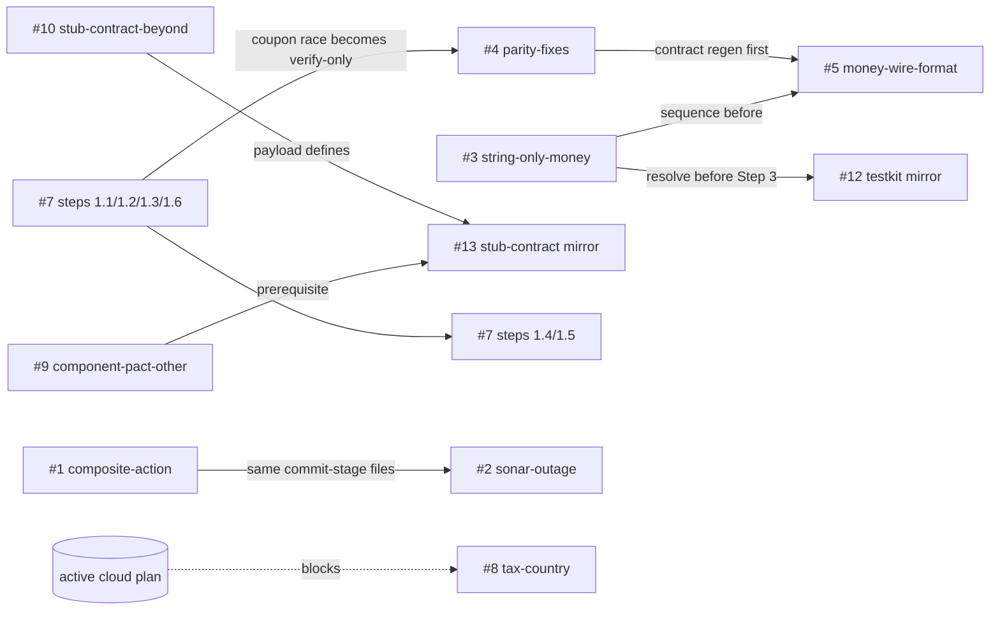

# 2026-10-29 12:56 UTC — Plan coordination meta-plan: backlog execution

> 🤖 **Picked up by agent** — `ValentinaLaptop` at `2026-10-30T16:54:16Z`

## TL;DR

**Why:** The 18 backlog plans overlap on the same files and contracts, several are already done or obsolete, and most are blocked on user decisions, so they can't safely be picked up in isolation while the cloud deploy plan is active.
**End result:** The backlog runs in a safe order: obsolete plans deleted, the two money plans merged, autonomous work done in two waves, and decision-gated work following once the user answers Q-A..Q-H, with no conflicting edits or docker clashes.

## ▶ Next executable step (resume here)

U1 is done and committed. Next: U2 (execute the refined `plans/backlog/p4-maintenance/20260917-1811-frontend-major-upgrades.md`, Vite 7 -> Vitest 3 -> React 19, one commit per step), then Wave 2 in parallel: U3 (`SecurityConfigTest` additions) and U4 (system-test driver items).

Read-only analysis of `plans/backlog/p1..p4`. No existing plan was edited. Repo state was spot-checked (grep/ls) to find stale premises.

## Plans analysed

18 in-scope plans (all read in full) + `plans/backlog/README.md`. Referenced only: the active cloud plan `plans/20261029-1316-deploy-shop-cloud-run.md` (marked "Picked up by agent"; Step 7 = user provisioning, Step 8 = first cloud run). `after-cloud-deploy/*` and `parked/*` were not read and are excluded.

Cloud-plan footprint (treated as owned): `*-cloud.yml` workflows, `terraform/`, `setup-gcp.sh`/`teardown-gcp.sh`, `docker/keycloak/Dockerfile.cloud` + `docker/keycloak/shop-realm.json` (realm import with URL substitution), cloud migration/stub Dockerfiles, `system-test/typescript/config/test-config-<env>-<mode>.json`, Neon/Secret Manager config.

## Per-plan status snapshot

Done/total = checkbox items. "Premise" = repo check on 2026-10-29.

| # | Plan (slug) | Folder | Done/total | Autonomy | Premise check |
|---|---|---|---|---|---|
| 1 | composite-action-for-stage-checks | p1 | 0/5 | needs-decision (OQ-A/B/C) | Valid: `_prerelease-pipeline.yml` `local` job still has inline lint steps. Parent plan `20260624-1049` no longer exists (assume landed) |
| 2 | sonar-outage-survives-commit-stage | p1 | 0/4 | needs-decision (policy 1-3) | Valid; most work is in sibling `optivem/actions` (exists at `../actions`). No Sonar step in any `*-cloud.yml` |
| 3 | string-only-money-surface | p2 | 0/5 items | needs-decision ("is breaking change acceptable") | Valid: `double` overloads and `Converter.fromDouble` still present in both Java testkits |
| 4 | cross-language-parity-fixes | p2 | 0/3 + 3 OQ | needs-decision (3 OQs, "resolve with /refine-plan") | Valid: `Internal server error:` still in 6 handlers; `between 22:00 and 23:00` still in all 7 backends; no `@Transactional`/atomic redeem in monolith/backend-java |
| 5 | money-wire-format-strings | p2 | 0/8 + 3 OQ | needs-decision | Valid: `ThenOrder` still has `double` |
| 6 | keycloak-auth-followups | p2 | 0/10 bullets | mixed (see units) | `SecurityConfigTest` exists in `monolith/java` and `backend-java` |
| 7 | production-readiness-chunk1-data-correctness | p2 | 0/6 steps (~25 sub-items) | mixed: 1.1/1.2/1.3/1.6 ready, 1.4/1.5 need decisions | Valid: no `@Version`, no idempotency table, migrations are only 3 files |
| 8 | tax-country-from-customer-location | p2 | 0/7 | needs-decision ("not yet approved to build") | Valid |
| 9 | component-pact-layer-other-multitier-backends | p3 | 0/6 | OBSOLETE (likely) | `backend-dotnet/Tests/Contract/BackendPactVerificationTest.cs`, `Tests/Component/`, `backend-typescript/test/pact/backend.pact.spec.ts`, `test/component/` exist |
| 10 | component-stub-contract-beyond | p3 | 0/2 open items (3, 4) | needs-decision ("discuss before executing") | Item 4 largely overtaken: Erp/Tax/Clock `*ParityContractTest` pairs now exist |
| 11 | orderhistory-systemtest-dsl-parity | p3 | 0/n | OBSOLETE (likely) | system-test Java has `ThenOrderHistoryImpl`, `WhenBrowseOrderHistoryImpl`, `BrowseOrderHistory{Positive,Negative}Test`; .NET has `ThenSuccessOrderHistory`; TS only partly verified |
| 12 | backend-testkit-alignment-cross-language-mirror | p3 | 0/4 | needs-decision (gated; Step 3 on string-only) | Java side shipped; `ErpDriver.returnsProduct` present |
| 13 | component-stub-contract-cross-language-mirror | p3 | 0/4 | needs-decision (payload defined by #10) | Depends on #10 outcome and #9 |
| 14 | legacy-twin-stub-fidelity-gap | p3 | 0 (options A/B/C) | needs-decision ("discuss before executing") | Valid: "byte-identical" prose still present in legacy `BackendPactVerificationTest` |
| 15 | tax-real-parity-contract-test | p3 | 0/5 work items | OBSOLETE (done) | `TaxRealParityContractTest`, `TaxStubParityContractTest`, `ClockRealParityContractTest`, shared `ExternalSystemReal.java` and `externalSimulatorImage` Gradle task all exist; `test-taxonomy.md` lists `{clock,erp,tax}` parity |
| 16 | integration-dsl-facade-symmetry | p3 | 0 | needs-decision (OQ1 "no recommendation") | Valid: `GatewayDsl` does not exist |
| 17 | sonarlint-backend-init-failure | p4 | 0/6 | needs-user (local IDE, not code) | n/a, machine-local |
| 18 | frontend-major-upgrades | p4 | 0/1 | autonomous-ready after `/refine-plan` (no user decision) | Valid: React ^18.2, Vite ^5.4, Vitest ^2.1.9 |

## Dependency graph

Edges only from explicit plan language, plus a few conservative sequencing edges (listed below the graph). `A --> B` = A lands before B.

- Declared hard edges: #3 -> #12 Step 3 (#12: "Resolve that plan before running Step 3"); #3 before #5 (#3 banner "sequence before the mirror"; #5 OQ2 couples them); #10 -> #13 ("payload defined by"); #9 -> #13 ("prerequisite for this one").
- Conservative edges added (not explicit; avoid same-file edits): #7(1.2) -> #4 coupon race; #4 -> #5 for `contracts/frontend-backend.json`; #1 -> #2 for commit-stage workflows.
- Cycles: none. Note #3 Item 4 edits the text of plan #12 (a plan-to-plan write; handled by merging, CS1).

## Conflicts

| ID | Class | Files | Plans / items | Resolution |
|---|---|---|---|---|
| C1 | hard (duplicate scope) | coupon read-then-write in `monolith/java`, `monolith/dotnet`, `backend-java`, `backend-dotnet` (`CouponService`/`OrderService`) | #7 step 1.2 vs #4 "Coupon usage race" | Run #7 first; #4's race item becomes verify-only (#4 already says "if any backend turns out already fixed, the item shrinks") |
| C2 | soft (same files, different regions) | `OrderService` (all 7 backends), `GlobalExceptionHandler` | #7 1.1/1.3, #4 blackout text + 500 detail, #8 item 3 | Serialise: #7A -> #4 -> #8 |
| C3 | hard | `contracts/frontend-backend.json` | #4 blackout (line ~888), #5 bodies+matchers, #8 item 4, #7 1.3.e/1.5 | Serialise: #7 -> #4 -> money -> #8. Pact provider verification runs in 3 backends, so each contract change lands with its backend edit in one commit |
| C4 | hard (merge-worthy) | `system-test/java` money assertions + verification layer; `ThenOrder`/`ThenOrderImpl` etc. | #3 vs #5 | Merge into one plan (CS1) |
| C5 | dependency | #12 Step 3 numeric-vs-String surface | #3 -> #12 | #12 Steps 3-4 stay blocked until #3 lands |
| C6 | claimed collision NOT confirmed | backend-java legacy twins (`component/legacy`, `integration/legacy`, `contract/internal/frontend/legacy`) vs String-only money | #14 vs #3 | An earlier meta-plan claimed a collision. Verified: legacy twins hand-write raw WireMock JSON and contain no numeric DSL money calls (the only numeric hit is the non-legacy `ErpStubConsumabilityContractTest`). No real collision |
| C7 | soft | `testSupport` DSL (`UseCaseDsl`, `ThenErp`, `ErpStubDriver`), `BaseGatewayIntegrationTest`, `docs/atdd/test-taxonomy.md` | #10 item 3, #16, #14, #12, #3 | All p3 plans blocked; if pursued, serialise: #14 -> #10 -> #16 -> #12 -> #13. The earlier-claimed `component-tests.yaml`/`build.gradle` collision is gone: its source, #15, is already done |
| C8 | soft vs active cloud plan | `docker/keycloak/shop-realm.json` (cloud Keycloak imports it) | #8 item 1 (realm users/attributes) | Do not schedule #8 until the cloud plan finishes |
| C9 | coordination vs active cloud plan | `system/db/migrations` (Flyway runs against Neon via the cloud migration image) | #7 1.3.a (new `version` column), #7 1.4 (`idempotency_keys`) | Additive expand-only migrations are safe; tell the cloud plan owner. Do not push migration commits while Step 8 is being debugged without user OK |
| C10 | coordination vs active cloud plan | frontend-react / backend-java images consumed by cloud deploy; `system-test/typescript/config` | #18, #7, keycloak-B (U4) | Cloud Step 8 may fix failures in `system-test/typescript/config`; keep U4's TS driver edits out of `config/` |
| C11 | soft | `*-commit-stage.yml` | #1 (compile/lint/unit/component), #2 (Sonar steps) | Serialise #1 -> #2; no merge needed (#1 scopes Sonar out) |
| C12 | soft | `system-test/*` drivers (`MyShopUiDriver`, `MyShopApiClient`) | U4 (keycloak), #3, #11 | U4 before money; #11 is obsolete |
| C13 | soft | `frontend-react` | #18, #5 (types), #8 (order form), #7 1.5.c (paging) | #18 first; the others are blocked anyway |

Shared-resource rule (not a file collision): `gh optivem system start` binds fixed docker ports and reuses cached images (stale images break UI tests). Only one session at a time may run it.

## Consolidation findings (decided)

| ID | Finding | Decision | Rec. |
|---|---|---|---|
| CS1 | #3 and #5 are one theme, overlap on system-test money assertions, and #3 Item 4 edits another plan's text | **Merge into a fresh plan `money-strings-end-to-end`** via `/create-plan` (Phase 1 = #3 Items 1-5 in Java; Phase 2 = #5 wire format: all backends, contract, 3 suites, frontend). Delete #3 and #5 once it lands. Alternative: keep both, re-order. Recommended: merge, because both plans' open questions (breaking change, rates, one-commit-vs-staged) are answered together and the merge removes the plan-to-plan edit | **recommended** |
| CS2 | #7 step 1.2 and #4 coupon-race item are the same fix in the same files | Re-order, no merge: #7A first, then #4 with the race item verify-only. Alternative: merge #4 + #7A (larger, and #4 still has 3 unresolved OQs). Recommended: re-order, because #7A has no open questions and #4 already tolerates "already fixed" | **recommended** |
| CS3 | #13 payload is defined by #10, which may ship nothing | Re-order: decide #10 first; if nothing ships, delete #13. Not merged | |
| CS4 | #9, #11, #15 are done or obsolete | **Delete** (below). Run `/review-plan` on #9 and #11 first because only existence checks were done | **recommended** |
| CS5 | #1 and #2 touch the same commit-stage workflows | Re-order #1 -> #2, no merge (disjoint steps) | |
| CS6 | #7 mixes ready items (1.1/1.2/1.3/1.6) and decision items (1.4/1.5) | Partial execution: `/execute-plan` scoped to 1.1, 1.2, 1.3, 1.6; leave 1.4/1.5 in the file. Alternative: split via `/create-plan`. Recommended: partial execution, because the plan itself says 1.1-1.3 need no API change and lists that order | **recommended** |

Deletion candidates (already done / obsolete):
- `plans/backlog/p3-test-parity/20260814-1610-tax-real-parity-contract-test.md` — confirmed done.
- `plans/backlog/p3-test-parity/20260616-0830-component-pact-layer-other-multitier-backends.md` — likely done, verify.
- `plans/backlog/p3-test-parity/20260717-1020-orderhistory-systemtest-dsl-parity.md` — Java and .NET done; verify TypeScript.

## Execution units

A = autonomous-ready, B = needs user decision (see Blocked on user).

| Unit | Plans / items | Type | Primary files | Autonomy |
|---|---|---|---|---|
| U1 | #7 steps 1.1, 1.2, 1.3, 1.6 | code, 3 languages, new Flyway migration | `OrderService`, `CouponService`, coupon/order repositories, `Order` entity, `GlobalExceptionHandler` (409) and equivalents, `system/db/migrations/V*__order_version.sql`, integration/concurrency tests in monoliths + multitier backends | A |
| U2 | #18 frontend upgrades (after `/refine-plan`) | dependency upgrade | `system/multitier/frontend-react/{package.json,package-lock.json,vite.config.*}` + test config | A (halt if refine finds a decision) |
| U3 | #6: `SecurityConfigTest` route enumeration; expired-token / wrong-audience cases | Java tests | `system/monolith/java/.../config/SecurityConfigTest.java`, `system/multitier/backend-java/.../config/SecurityConfigTest.java` | A |
| U4 | #6: UI order-details direct-URL ownership check; UI support for access-denial acceptance tests then widen `@Channel`; unify default-identity resolution | system-test drivers, 3 languages | `system-test/{java,dotnet,typescript}` `MyShopUiDriver`, `MyShopApiClient`, affected acceptance tests | A (stop and report if the UI driver needs a redesign) |
| U5 | #4 parity-fixes (race verify-only, 500 detail, blackout text) | code + contract regen | 7 backends, `contracts/frontend-backend.json`, `CancelOrderNegativeIsolatedTest` x3, frontend interactions | B (Q-C) |
| U6 | CS1 merged `money-strings-end-to-end` | code, all layers | see CS1 | B (Q-B) |
| U7 | #7 steps 1.4, 1.5 | API change | idempotency table, pagination, frontend | B (Q-D) |
| U8 | #8 tax-country | API + test change | see plan | B (Q-E) |
| U9 | #6 remainder | mixed | .NET auth, actuator, npm audit | B (Q-F) |
| U10 | #1 composite action, #2 sonar outage | CI, cross-repo | `optivem/actions`, `*-commit-stage.yml`, `_prerelease-pipeline.yml` | B (Q-G) |
| U11 | #17 SonarLint | local IDE | none in repo | B (Q-H, manual) |
| U12 | p3 cluster: #14, #10, #16, #12, #13 | test architecture | see C7 | B (Q-A; README gate: "decide first whether to pursue at all") |

## Execution waves

Autonomous-ready units only. Rules for every batch: execute in-session via subagents (no `/clear` hand-offs); verify per the repo CLAUDE.md (`./compile-all.sh`, then `gh optivem system-test run --sample` per affected language); commit/push only through `/commit`; the cloud plan is active, so run the pre-execute checks first.

### Wave 1

| Batch | Mode | Units / plans | Files owned | Sessions | Pre-execute commands |
|---|---|---|---|---|---|
| 1A | serial; holds the docker lock for its system-test gate | U1: #7 steps 1.1, 1.2, 1.3, 1.6 | backend sources + tests in `system/monolith/*` and `system/multitier/backend-*`, `system/db/migrations` | 1 orchestrating session, subagents per language (Java -> .NET -> TS) | `git status`; confirm the cloud plan has not touched `system/db/migrations` |
| 1B | parallel with 1A for code and static checks; its `system start` gate waits until 1A releases the docker lock | U2: #18 frontend upgrades | `system/multitier/frontend-react/**` | 1 | `/refine-plan plans/backlog/p4-maintenance/20260917-1811-frontend-major-upgrades.md` (creates steps; no user decision expected) |

1A and 1B own disjoint files. If 1A step 1.3.e touches `contracts/frontend-backend.json` and 1B's Pact run regenerates it, check `git diff contracts/` before committing 1B.

### Wave 2 (after Wave 1 is committed)

| Batch | Mode | Units | Files owned | Sessions | Pre-execute |
|---|---|---|---|---|---|
| 2A | parallel-safe (disjoint files) | U3 SecurityConfigTest additions | the two `SecurityConfigTest.java` files | 1 | read the existing tests first (the plan says so) |
| 2B | parallel-safe with 2A; holds the docker lock | U4 system-test driver items | `system-test/{java,dotnet,typescript}` drivers and affected acceptance tests (not `system-test/typescript/config/`) | 1 orchestrating + 1 subagent per language | none |

No later wave of autonomous-ready units exists. Once the user answers, the follow-on order is: U5 (#4) -> U6 (money) -> U7 (#7B) -> U8 (#8, only after the cloud plan finishes); U10 (#1 then #2) and U12 are independent of that chain.

## Blocked on user

Answering "accept all recommendations" unblocks the whole section.

**Q-A. p3 gate (README: "decide first whether to pursue at all").** Pursue the test-parity track? Recommended: pursue narrowly. Delete the 3 done/obsolete plans now; most remaining p3 items are parity polish with no correctness payoff, so only the cheap ones should survive.
- Q-P3a (#14 legacy-twin): option A now (replace the "byte-identical" prose with an honest frozen-snapshot note), C as a separate later discussion, not B. **Recommended: A.**
- Q-P3b (#10): reject item 3 (ERP interaction verification; couples tests to implementation); drop item 4 (parity pairs now exist; no test can detect the difference). **Recommended: reject 3, drop 4**, then delete #10 and #13 (CS3).
- Q-P3c (#16 facade): option A (leave as-is; the win is about 3 lines of duplication). **Recommended: A**, delete #16.
- Q-P3d (#12 mirror): run Steps 1-2 (survey + driver-port vocabulary) only; Steps 3-4 wait for the money merge. **Recommended: yes**, sequenced after U6.

**Q-B. Money (CS1 merged plan).**
1. Accept the breaking change of deleting numeric DSL overloads? **Recommended: yes**, the DSL shape is the lesson.
2. Do rates become strings too? **Recommended: yes, all decimal fields**, one rule.
3. One commit vs staged per language? **Recommended: one coordinated change set (all backends + consumers) built in one session and committed together**, because the Pact contract is shared and a transition window adds permanent complexity.
4. Pre-approve running system tests (the plans say "ask, never self-initiate")? **Recommended: yes, `--sample` only**, per the repo CLAUDE.md gate.

**Q-C. #4 parity-fixes.**
1. Explicit rounding in the four backends? **Recommended: yes**, mirror `OrderPricing`; the rounding rule should be visible in code.
2. Coupon race shape (after U1 lands)? **Recommended: (a) conditional UPDATE**, same as #7 1.2.a; item becomes verify-only.
3. 500 `detail` text? **Recommended: adopt `"An unexpected error occurred. Please try again later."` verbatim in the other six.**

**Q-D. #7 steps 1.4 / 1.5.**
1. Idempotency scope/TTL: **per authenticated user, 24 h.**
2. Same key, different body: **422.**
3. Pagination: **optional `page`/`size`, default 50, cap 100; UI paging controls out of scope.**
4. Search indexing: **option (3), accept as is, document the trade-off.**
5. Race tests: **integration tests for races, acceptance scenarios for single-call behaviour.**

**Q-E. #8 tax-country** (also gated on the cloud plan finishing, C8).
1. Where does country live? **Keycloak user attribute exposed as a `country` claim.**
2. Customer has no country: **reject with "Customer country is not set".**
3. Keep `country` on `Order`: **yes.**
4. First pass: **monolith java + system-test java, then port.**
5. Timing vs the paid article: **defer until the article decision; confirm the change is wanted at all** (product call, no content recommendation).

**Q-F. #6 remainder (U9).**
1. Actuator/swagger on backend-java public? **No, leave authenticated.**
2. Simulators need auth? **No.**
3. `npm audit` warnings: **`npm audit fix` non-breaking only; ignore the rest.**
4. .NET intermittent UI flake: **treat as mitigated, close the bullet.**
5. .NET central route table / JWKS retry: **defer; not needed for a teaching template.**

**Q-G. CI (#1, #2).**
1. #1: per-concern actions vs one parameterised (OQ-A)? **Per-concern.** Commands owned by the action (OQ-B)? **Yes.** Pinning (OQ-C)? **Match the existing `optivem/actions` pin convention in shop.** Approve a cross-repo change to `optivem/actions`? **Yes.**
2. #2: outage policy? **(b) non-blocking on transient 5xx exhaustion only; quality-gate failures still fail.** Skipped-analysis notice: **job-summary warning.** Acceptance stages: **same policy as commit stages.** Step 1 (re-point `optivem/actions` `v1` to `cd0432c` via `update-v1.yml`) is independent; **recommended now**, before the policy is decided.

**Q-H. #17 SonarLint.** Machine-local; no agent can verify. **Recommended: do it by hand (steps 1-6 in order) or delete the plan.**

## Pre-execute checks

Run before any wave:

1. `grep -l "PICKUP\|in-flight\|claimed by\|Picked up by agent" plans/*.md plans/backlog/*/*.md` — on 2026-10-29 this matched the cloud plan (real "Picked up by agent" marker) and `tax-real-parity-contract-test.md` (false positive: the word appears in prose). Any new hit means another agent is in flight; stop and ask.
2. `git status` — at analysis time `.github/workflows/multitier-java-acceptance-stage-cloud.yml`, `plans/20261029-1316-deploy-shop-cloud-run.md` and `terraform/README.md` were modified by the cloud plan. Do not touch or stage those.
3. The cloud plan `plans/20261029-1316-deploy-shop-cloud-run.md` is **active** (someone else is executing; Step 7 is user provisioning, Step 8 a first cloud run). Do not edit its files (footprint above). Pushes to `main` change the images it deploys; get user OK before pushing while Step 8 is in progress.
4. `git config core.hooksPath .githooks` is set (repo CLAUDE.md).
5. No docker stack running (`gh optivem system stop`) before the first system-test gate; rebuild images with `--no-cache` if UI tests time out on `aria-label="SKU"`.

## Suggested run order

1. User (a few minutes): answer Q-A..Q-H; delete the three obsolete plans (run `/review-plan` on #9 and #11 first if unsure; #15 is confirmed done). Do Q-G.2 Step 1 whenever convenient.
2. Pre-steps: `/refine-plan` on the frontend-upgrade plan. Merged-plan creation via `/create-plan` for CS1 (`money-strings-end-to-end`) only after Q-B is answered.
3. Wave 1: one session runs `/execute-plan` on `plans/backlog/p2-product-correctness/20261009-1545-production-readiness-chunk1-data-correctness.md` scoped to steps 1.1, 1.2, 1.3, 1.6, with subagents per language; a second session runs `/execute-plan` on the refined frontend-upgrade plan. Commit each via `/commit`.
4. Wave 2: `/execute-plan` on the keycloak plan scoped to U3 items, and in parallel a second session on U4 items.
5. After answers arrive: U5 (`cross-language-parity-fixes`), then U6 (merged money plan), then U7, U10 (#1 then #2), U12 in the order above; U8 only after the cloud plan finishes.

## Out of scope

- `plans/backlog/after-cloud-deploy/*` (pinned-sha gate, QA smoke tests, test-order alignment, production-readiness-gaps parent) and `plans/backlog/parked/*` — not read; blocked on or separate from the cloud plan.
- Editing any existing plan, running `/execute-plan`, committing or pushing.
- Content of the `optivem/actions` repo beyond confirming the sibling checkout exists.
