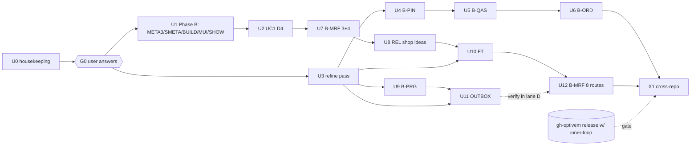

# 2026-11-16 20:03 UTC — Plan coordination meta-plan: all shop plans

> 🤖 **Picked up by agent** — `Valentina_Desk` at `2026-11-23T09:16:10Z`


## TL;DR

**Why:** Shop has 21 open plans: three earlier meta-plans, the in-flight storefront/showcase/reliability work and the backlog. They share the one local docker host, the system-test drivers, the acceptance/QA/prod workflows and `frontend-react`, and several backlog plans were overtaken by later work. Running them one by one by hand repeats the docker clashes and double orchestration that REL #36/#45/#56 recorded.
**End result:** One `/execute-plan plans/20261116-2003-meta-all-shop-plans.md` drives every remaining shop improvement to done, in a safe order. The three older meta-plans are retired into this one, obsolete plans are deleted, and every child plan is deleted as it finishes. The plans left at the end are only the ones the user deliberately parks (deferred items, `backlog/parked/`).
**Unchanged:** child plans stay the source of truth for their items (this file never copies their steps). `backlog/parked/` plans are tracked but unscheduled. Everything touching another repo runs last (user decision, 2026-11-06), and shop never edits gh-optivem (read-only, 2026-11-06).

## How to run

```
/execute-plan plans/20261116-2003-meta-all-shop-plans.md
```

The orchestrating session runs the **Wave tracker** top to bottom. Run the same command again to resume.

**Orchestrator protocol:**
- **One subagent per unit:** a fresh `general-purpose` agent, never `isolation: "worktree"`. Its brief has the unit row below, the child plan's path (it reads its own items there), repo `CLAUDE.md`, and the lane rules. Subagents run `/execute-plan` rules on the child: they work its items, delete finished items and refresh the child's ▶ block.
- **Verify, don't trust:** after each unit, check `git log origin/main` plus the unit's gate (compile, `--sample`, CI run id) before ticking it here.
- **Lanes:** units in different lanes may run at the same time. Units in one lane run strictly one after another. **Lane D (docker)** is the only lane allowed to run `gh optivem system start` / `system-test` / `test-all.sh`. Check `docker ps --filter name=my-shop` before every Lane D step, start stacks with `--restart`, run one stack at a time, and keep ≥5 GB free RAM (REL #66).
- **Commits:** `gh optivem commit --repo shop --paths …` with exactly the unit's files, never `--all` (REL #56). Plan-file edits are committed on their own.
- **Incidental issues** go into REL `plans/20261110-1207-system-test-reliability-followups.md` as new numbered ideas with a recommendation (pull first). Never fix them inside an unrelated unit.
- **Failures:** two fix-forward retries per unit. After that, record the blocker in the tracker, skip that unit's lane, and carry on with the other lanes.
- **Stop only at 🛑 gates, a blocker, or an expensive-to-reverse fork** (schema or public-API change not covered by a decision).
- **Close-out:** when every unit is done or parked, delete this file. Then report what's left: parked items and units waiting on other repos.

## ▶ Next executable step (resume here)

**Watch:** meta-prerelease **45136998785** (testing `d5f4016d`): all 14 cross-lang jobs are green, so the Java breaker fix works. Only the multitier dotnet/typescript/java pipeline jobs were still running on 2026-11-23 ~12:00 UTC. If one goes red, triage it before U20. Also confirm `multitier-backend-clean-java-commit-stage` is green on `b8ce6935` (it had been red since 2026-11-18, REL #104).

**Wave 4b, U20 Flyway 13 (#95) + docker-minor-patch group (#91)** (Lane D). Read both PRs (`gh pr diff`; bases may be stale, compare with main). Flyway: Boot 4.1 manages 12.4.0 (U19, `e467f3f6`), so Flyway 13 means overriding the Boot-managed version in the Java backends (or wherever #95 targets, e.g. the `db-migrate` image / `system/db`); check Flyway 13's breaking changes against the migrations in `system/db/migrations` and the `db-migrate` service. Docker group #91: apply the image bumps it proposes (compose files / Dockerfiles). Gate: `./gradlew build` per touched Java project; for image/compose bumps, `--sample` on every stack that uses the bumped image (at least monolith-java + multitier-java; all six if `db-migrate`/postgres changes), one at a time, `./gradlew --stop` first, ≥5 GB free. Commit `--paths` exactly; check CI on the pushed head; close superseded PRs. After U20, Wave 4b is complete → next is X1 (plans-only in other repos, standing answer).

## Wave tracker

| Wave | Unit | Lane | State |
|---|---|---|---|
| 0 | U0 plan-only housekeeping | — | done 2026-11-17 |
| 0 | 🛑 G0 user answers | — | done 2026-11-16 |
| 1 | U1 Phase B finish (META3) | D | done 2026-11-17 up to `897bbe33` (test-all 12/12, all 12 UCs implemented, SPEC/BUILD/SMETA deleted); MUI visual check approved by the user 2026-11-18; MUI + SHOW deleted, MUI Step 2 + 11 follow-up ideas moved to `backlog/parked/20261118-1400-market-ui-follow-ups` |
| 1 | U2 UC1 Track D4 | D (after U1) | done 2026-11-17: UC1 deleted (`513c47ed`), Java UC-009.2 fixed (`db087f76`), spec-gate strict with user-approved waivers for UC-005.7 / UC-011.2 until 2027-02-17 |
| 1 | U3 plan refinement pass (FT, OUTBOX, B-ORD, B-PRG prune, B-QAS prune, B-PIN retarget) | P | done 2026-11-17 (`0e6bba99`) |
| 2 | U4 B-PIN pinned-SHA gate (now verification only: one pinned-SHA dispatch) | W | done 2026-11-17: run 44087239748 green, gate didn't skip, RC tag on `db087f76`; plan deleted (`9e7cd5ef`) |
| 2 | U5 B-QAS remainder (verification only: smoke ran green before record/release) | W (after U4) | done 2026-11-17 (`e0e3c925`); Steps 2–3 are X1 |
| 2 | U6 B-ORD shop steps | W (after U5) | done 2026-11-18: `5dabd1d2` confirmed in CI (docker-compose 44296859054, cloud 44212978049: contract before acceptance, green); Steps 3–5 are X1 |
| 2 | U7 B-MRF #3 + #4 | D (after U2) | done 2026-11-17 (`c094da41`, `49a5cf12`): new UC-002.11 deep-link UI test ×3 languages, .NET cancel UI now drives the UI |
| 2 | U8 REL open ideas, shop side | D (after U7) | 2026-11-18: #55 #56 #58 #59 #64 #66 #67(1) #69 #75 #76 #80 #84 done; #78 headers + report-only CSP; #68 done (`0cd89824`, `f8a57fb9`); #82 done (`a57c88f7`, all six stacks green); #61 → watch; left: #78 enforcement only (needs a cloud multitier UI run) |
| 3 | U9 B-PRG remainder | B | done 2026-11-20: meta-release 44784247292 green; all 6 prod-stage runs (44784651931…44784660011) took the snapshot, signed the images with cosign, and PUT brute-force on `shop-prod`; B-PRG deleted. No `cosign verify` gate in CI (REL #93) |
| 3 | U9b REL #78 enforce the frontend-react CSP | D | done 2026-11-20 (`f02a79a1`): local Playwright probe 0 violations (report-only and enforced, incl. Keycloak sign-in, OTLP origin set); `--sample` multitier ×3 11/11; CI green. Cloud Keycloak origin still unprobed (REL #94) |
| 3 | U10 FT frontend testing | D (after U8) | done 2026-11-18: Lighthouse run 44331924479 green (3 pages; warn budgets `25bfb043`), SignIn axe test `8d5ace02`, REL #70 rechecked per criterion (`d7841c8c`, UC-008.11 test `e73bde72`); FT deleted (`32fe298b`) |
| 3 | U11 OUTBOX (confirmed 2026-11-17: Java-only worked example, a noted shortcut) | B (after U9), verified in D | done 2026-11-17, plan deleted; Lane D verified: relay delivers, `sent_at` set, audit rows written |
| 4 | U12 B-MRF #8 path-param routes | D (after U10) | done 2026-11-20 (`82eff412`): all 14 cross-lang jobs of meta-prerelease 44750478153 green (local cross-lang timeouts were REL #92, host RAM) |
| 4b | U13 GitHub Actions majors (#118–#123: upload-artifact 7, setup-go 7, cache 6, setup-dotnet 6, setup-node 7) | W | done 2026-11-20 (`7750351c`): 43 `uses:` bumps, actionlint clean, 15/15 push runs green, PRs closed by Dependabot |
| 4b | U14 Node 26 (images #92 #99 #103 #104; `@types/node` 26 #108 #110 #112 #117) | D | done 2026-11-20 (`63fc762e`, vitest webstorage fix `9b6a063c`): compile-all ×7, `--sample` monolith-ts + multitier-ts 6/6, CI green, PRs closed; `engines` floors left at `>=22` |
| 4b | U15 ESLint 10 | D (after U14) | done 2026-11-20 (`97266b2f`) for system-test, backend-typescript and frontend-react (lint/typecheck/tests green; 2 `no-useless-assignment` fixes); monolith stays on ESLint 9, blocked by eslint-config-next's plugins (REL #95, PRs #141/#109 left open) |
| 4b | U16 .NET 11 (sdk/aspnet images #97 #98 #101 #102, TFMs, System.Text.Json 11 #133 #134, MS.Extensions #127, nuget minor group #144) | D (after U15) | done 2026-11-23 (`6675bc4e`): compile-all 7/7, `--sample` monolith-dotnet + multitier-dotnet 11/11 each; CI green (pushed head `bb35d7d2`); PRs closed |
| 4b | U17 .NET test deps majors (WireMock.Net 2 #132 #135 #146 #147, coverlet 10 #145) | D (after U16) | done 2026-11-23 (`104941ad`): WireMock.Net 1.25→2.31, coverlet 6.0.4→10.1.1, no code changes; compile-all 7/7, `dotnet test` backend 139/139, `--sample` dotnet ×2 11/11; cleared REL #96; PRs closed; CI green (head `83ee871e`) |
| 4b | U18 Gradle 9.9 (#136–#139) | D (after U17) | done 2026-11-23 (`dcc0d973`): wrapper 8.14.3 → 9.9.1 in all 4 Java builds (networkTimeout kept at 60000), `./gradlew build` ×3 + system-test `testClasses` green, `--sample` monolith-java + multitier-java green; compile-all killed by the memory reaper (REL #99); Gradle 10 deprecations → REL #98; CI pending |
| 4b | U19 Spring Boot 4.1 (#87 #90 #94 #96) | D (after U18) | done 2026-11-23 (`e467f3f6`): Boot 3.5.6 → 4.1.2 (Spring 7, Testcontainers 2, JUnit 6, Hibernate 7; springdoc 3.2.0; Jackson 2 kept via the `spring-boot-jackson2` bridge → REL #100); build ×3 + `--sample` java ×2 green; REL #101–#103; CI pending |
| 4b | U20 Flyway 13 (#95) + docker-minor-patch group (#91) | D (after U19) | todo |
| 5 | X1 cross-repo (last) | X | todo |
| — | M manual (user) | — | open; **M-GCP** done 2026-11-18, user actions below |

### M-GCP follow-ups — done 2026-11-18 (`6a40c010`, `78d5c4b5`); user actions

- Done 2026-11-18: `./setup-gcp.sh` created and stored `shop-monolith-session-secret` (REL #76; plan 2 to add, 0 to change, 0 to destroy).
- **User:** meta-release now waits for approval in the `production-release` environment (REL #80, `ed389f13`); approve or reject it on the run page.

## Per-plan status snapshot

Snapshot 2026-11-16 (`main` at `054e06dd`; pipeline green; UC status: 001, 004, 006, 007, 008 `implemented`; 002, 003, 005, 009–012 `planned`).

| Short | Plan | Status | Remaining | Primary files (remaining work) |
|---|---|---|---|---|
| META1 | `20261104-1148-meta-backlog-execution` | meta; M1–M5, M7 done | M6 = GHO only | itself |
| META3 | `20261112-0845-meta-storefront-ui-showcase-reliability` | meta; Phase A coded; Phase B .NET pass in progress since 11-12; stale pickup marker (this machine, 11-12) | Phase B: .NET + TS passes, `test-all.sh`, flips, D4, MUI visual check | itself, Phase B fixes in `system-test/**` |
| SMETA | `20261107-1705-meta-storefront-specs-build` | meta; Steps 7/7b coded | Phase B verify + flips, Step 8 close-out | SPEC/BUILD files, `acceptance-criteria.md` status flips |
| SPEC | `20261107-1638-storefront-use-cases-rules-acceptance` | only standing rule left | deleted at SMETA close-out | — |
| BUILD | `20261107-1657-storefront-implementation` | Steps 8, 10 coded | verify + flip | `system-test/**` latest tests |
| UC1 | `20261106-1533-use-cases-match-substack-articles` | D1–D3 coded | D4 (+ lenient→strict decision) | `_acceptance-stage-docker-compose.yml` spec-gate step, `spec-*.yaml` |
| MUI | `20261111-1814-market-ui-redesign-all-screens` | **deleted 2026-11-18** (visual check approved) | leftovers parked as P-MUI | — |
| SHOW | `20261111-1831-interview-showcase-skill-gaps` | **deleted 2026-11-18** | — | — |
| REL | `20261110-1207-system-test-reliability-followups` | #1–#54 decided; X1 work done but entries #32–#34, #36–#45 still listed | #11 (user); undecided #55–#68; deferred #5 #15 #17 #20 #21 #26 #47 | varies per idea |
| FT | `20261112-0939-frontend-testing-component-a11y-lighthouse` | needs refine (3 open questions) | Steps 1–6 | `frontend-react/src/**` tests, `system-test/*` UI driver axe check, new LHCI workflow, `docs/tour.md` |
| OUTBOX | `20261112-0939-transactional-outbox-postgres` | needs refine (3 open questions) | Steps 1–7 | `system/db/migrations`, place-order service ×6 backends, relay, `docs/tour.md` |
| GHO | `20261103-1049-gh-optivem-driven-shop-changes` | ⏳ deferred (user, 11-06) | Item 3 rehearsal, Item 4 5c ticket + rehearsal | `system-test/java/**` (rehearsal writes), shop issue |
| INL | `20261103-1335-readd-inner-loop-pilot-config` | blocked on a gh-optivem release (latest `v1.6.108` predates the move) | Steps 1–2 | `gh-optivem-multitier-java.yaml` |
| B-PIN | `backlog/after-cloud-deploy/20260825-1426-acceptance-gate-pinned-sha-no-silent-skip` | not started; **file refs stale**: the gate now lives in `_acceptance-stage.yml` / `_acceptance-stage-docker-compose.yml` | Steps 1–6 | the two reusable acceptance workflows (+ legacy callers) |
| B-PRG | `backlog/after-cloud-deploy/20261009-1521-production-readiness-gaps` | Chunk 1.1–1.6 done; **much of chunks 2, 3, 5, 6 landed via SHOW** (resilience, OTel, Dependabot/CodeQL/Trivy/SBOM, k6) and cloud deploy (6.1) | 0.1, 1.7, 1.8, unshipped parts of 2–6 | backends ×6, workflows, `docs/` |
| B-QAS | `backlog/after-cloud-deploy/20261016-1058-qa-stage-smoke-tests` | **shop side likely done**: `_qa-stage.yml` and `_prod-stage.yml` already run smoke | verify; Step 6 (gh-optivem), Step 7 (courses) | `_qa-stage.yml`, `_prod-stage.yml` |
| B-ORD | `backlog/after-cloud-deploy/20261016-1117-align-test-order-with-environment-model` | not started; 3 open questions | Steps 1–2 shop; 3 gh-optivem; 4–6 courses | `_acceptance-stage*.yml`, `system-test/*/tests.yaml` |
| B-ACT | `backlog/p1-ci-pipeline/20261103-1042-optivem-actions-retry-release` | **done in effect**: `actions` `v1` = `main` = `21972ff` (v1 moves automatically on every push) | none | — |
| B-KC | `backlog/p2-product-correctness/20261007-1114-keycloak-auth-followups` | nothing actionable (one deferred item) | — | — |
| B-TAX | `backlog/p2-product-correctness/20261021-2122-tax-country-from-customer-location` | **overtaken**: UC-001 BR-3 now takes tax from the shipping address (BUILD Step 2) | only item 7 (substack draft) may still apply | — |
| B-MRF | `backlog/p2-product-correctness/20261103-1336-meta-run-followups` | open | #3 React deep link, #4 .NET cancel UI, #8 path params (decision); #6 and the `--test` bullet already moved to gh-optivem plans; #7, #9 watch-only | `frontend-react` auth, `system-test/dotnet` cancel driver, monolith routes + UI drivers |
| B-TKA | `backlog/p3-test-parity/20260720-1055-backend-testkit-alignment-cross-language-mirror` | Steps 3–4 "only on a new decision" | unscheduled | — |
| B-LEG | `backlog/p3-test-parity/20260814-1530-legacy-twin-stub-fidelity-gap` | option C deferred (discussion) | unscheduled | — |
| B-SL | `backlog/p4-maintenance/20260814-2000-sonarlint-backend-init-failure` | manual, local IDE | user | — |

| P-LVL | `backlog/parked/20260618-0701-place-order-test-levelling-worked-example` | parked; a paid article's code blocks wait on it | unscheduled | — |
| P-BRK | `backlog/parked/20260625-0913-pact-broker-default-contract-distribution` | parked; blocked on hosting a persistent broker (also against the $0 default, `[[feedback_templates_propagate_cost_to_students]]`) | unscheduled | — |
| P-MUI | `backlog/parked/20261118-1400-market-ui-follow-ups` | parked; MUI Step 2 (deferred) + 11 follow-up ideas | unscheduled | — |
| P-OAS | `backlog/parked/20260818-1130-openapi-response-schemas-clean-java` | parked; cosmetic, nothing consumes the spec | unscheduled | — |

Not plans: `move-to-*/README.md`.

## Dependency graph



Edges from the plans' own wording: META3 "TS pass → test-all → flip → UC1 D4"; UC1 "D4 after the test phase; recount"; FT/OUTBOX "Refine first"; INL "only after a gh-optivem release"; META1/GHO "everything touching gh-optivem goes last". The conservative edges (marked so) serialise same-file work: B-PIN → B-QAS → B-ORD (workflows), U7 → U8 → U10 (system-test drivers), B-PRG → OUTBOX (place-order service). No cycles.

## Conflicts

### 1. Local docker host — coordination conflict (Phase B, MUI, SHOW, B-MRF, FT, OUTBOX, REL)
- Every one of these runs system tests. REL #36, #45 and #56 record what happened when two sessions shared the host.
- **Resolution:** one serial **Lane D** (protocol above), in the order U1 → U2 → U7 → U8 → U10 → U12, with OUTBOX's system-level check fitted in after U10.

### 2. `_acceptance-stage*.yml` — hard conflict (UC1 D4 ↔ B-PIN ↔ B-ORD ↔ REL #67)
- D4 may flip the spec-gate step to `--mode strict`. B-PIN rewrites the `check` job's skip conditions. B-ORD reorders the suite steps. REL #67 adds an image-staleness warning to the same stage.
- **Resolution:** serialise with a rebase between: U2 (D4, Lane D) → U4 (B-PIN) → U6 (B-ORD) → REL #67 inside U8. Lane W starts U4 only after U2 is pushed.

### 3. `system-test/**` UI drivers — soft conflict (U1 fixes ↔ B-MRF #4/#8 ↔ FT Step 4 ↔ REL #65/#67)
- **Resolution:** Lane D order (Conflict 1). No two of these touch the drivers in parallel.

### 4. `_qa-stage.yml` / `_prod-stage.yml` — soft conflict (B-QAS ↔ B-PRG 5.4 cosign / 6.3 rollback ↔ REL #47 deferred)
- **Resolution:** B-QAS first (U5); B-PRG's prod-stage items in U9 come after it. REL #47 stays deferred.

### 5. Place-order service + `system/db/migrations` — soft conflict (B-PRG 1.7/1.8 ↔ OUTBOX)
- **Resolution:** Lane B: U9 then U11. Migrations are forward-only and expand-only (CONTRIBUTING).

### 6. `frontend-react` — soft conflict (B-MRF #3 deep link in `auth/` ↔ FT component tests ↔ MUI follow-up idea 7 `AuthGate.tsx`)
- **Resolution:** U7 before U10. MUI follow-ups stay unscheduled.

### 7. Duplicate scope — B-PRG vs SHOW (shipped)
- B-PRG 2.1–2.2 (resilience), 3.1–3.2 (metrics, OTel), 5.1–5.4 (Dependabot, CodeQL, Trivy, SBOM) and 6.7 (k6) were delivered by SHOW Steps 2–5. 6.1 (Terraform/Neon) was delivered by the cloud deploy, and 6.2 (expand-contract) is in `CONTRIBUTING.md`.
- **Resolution:** consolidation #3.

### 8. Dependency inversion — B-TAX vs the implemented UC-001
- B-TAX removes `country` from the request and reads it from a Keycloak claim. UC-001 BR-3 (implemented, BUILD Step 2) takes it from the shipping address. Executing B-TAX would break a gated, implemented spec.
- **Resolution:** consolidation #4.

### 9. Three meta-plans driving the same units — coordination conflict (META1, META3, this file)
- **Resolution:** consolidation #1.

## Consolidation findings (decided)

### 1. Retire META1 and META3 into this file — recommended
- META1's only open item is M6 = GHO, which becomes X1 here. META3's Phase B becomes U1, its Wave 2 (UC1 D4) becomes U2, and its Phase B checklist stays readable in git history: U1's brief points at `git show 06ac783d:plans/20261112-0845-meta-storefront-ui-showcase-reliability.md`. SMETA stays as U1's inner driver for SPEC/BUILD, since it owns their edits.
- **Why:** two live meta-plans over the same units is the double-orchestration META3 itself retired META2 for. Per `[[feedback_new_plan_not_extend]]` this is a fresh file. META1 and META3 are deleted in U0, not edited.

### 2. SMETA, BUILD, SPEC, MUI, SHOW, UC1 D4 — one Phase B unit (U1) plus U2, no merge
- They are all "coded, untested". Their gates overlap (one `test-all.sh` proves MUI Step 9 and the whole Phase A).
- **Resolution (recommended):** run them as U1 in one Lane D session, with a subagent per language pass, then U2. **Why:** one `test-all.sh` instead of four, and the flips happen once against a settled `main`.

### 3. B-PRG — prune against SHOW, then execute the remainder (U3 → U9) — recommended
- In U3, run `/review-plan` on B-PRG: delete items SHOW or the cloud deploy already delivered (Conflict 7), keep 0.1, 1.7, 1.8, 2.3, 3.3–3.5, 4.1–4.4, 5.5, 5.6, 6.3–6.6 if still open, and resolve its open questions from G0.
- **Why:** executing it as written would redo shipped work and collide with SHOW's files. Alternative considered: merge into SHOW, rejected because SHOW is code-complete and is deleted after U1.

### 4. Retire B-TAX and B-ACT; keep B-KC — recommended (confirmed at G0)
- **B-TAX:** overtaken by the shipping-address design (Conflict 8). Before deleting it, move its item 7 (update the substack characterization-tests draft, whose snippet still passes the country per order) into a one-line follow-up for the substack repo, reported at close-out.
- **B-ACT:** its goal is met: `v1` is `21972ff` = `main` and moves on every push.
- **B-KC:** holds only a deferred item and its context. Keep it; it gets no unit.

### 5. B-QAS and B-PIN — premise check before executing (in U3)
- **B-QAS:** `_qa-stage.yml` and `_prod-stage.yml` already run smoke tests. `/review-plan` prunes its done shop steps, leaving at most a verification (U5) plus Step 6 (gh-optivem) and Step 7 (courses), which go to X1.
- **B-PIN:** its line numbers and per-variant files predate the single-pipeline move. `/review-plan` re-targets it to `_acceptance-stage.yml` / `_acceptance-stage-docker-compose.yml` (and the legacy callers) before U4.

### 6. REL entries for finished X1 work — delete in U0
- #32, #33, #34 (fixed in `actions` `21972ff`) and #36–#45 (moved to gh-optivem plan `4ab210be`) are done or moved from shop's view, so U0 deletes them from REL.

## Execution units (post-consolidation)

| Unit | Plans / items | Lane | Gate | Primary files |
|---|---|---|---|---|
| U0 | Housekeeping: delete META1 and META3; remove META3's stale marker first; delete REL #32–#34 and #36–#45; delete B-TAX (after moving item 7) and B-ACT once G0 confirms | — | plan-only commit | plan files only |
| U1 | META3 Phase B: .NET pass → TS pass (REL #43 check, #60, k6 smoke per #63) → SHOW Phase B (Steps 3, 5, 6; 4b by `workflow_dispatch`) → `./test-all.sh` → flip every use case whose tests pass → SMETA Step 8 close-out (delete SPEC, BUILD, SMETA) → 🛑 MUI visual check (user) → delete MUI, SHOW | D | `test-all.sh` green; `spec status` per language | `system-test/**` fix-forward, `acceptance-criteria.md` flips |
| U2 | UC1 D4: recount, `spec status` ×3, choose strict vs lenient (G0), push, confirm the acceptance stage passes `spec-gate`; delete UC1 | D | CI acceptance stage green | `_acceptance-stage-docker-compose.yml`, `spec-*.yaml` |
| U3 | `/refine-plan` FT, OUTBOX and B-ORD with the G0 answers; `/review-plan` B-PRG, B-QAS and B-PIN (consolidations #3, #5) | P (plan-only) | each child ▶ block executable | those plan files |
| U4 | B-PIN, re-targeted | W | actionlint + one pinned-SHA dispatch | reusable acceptance workflows |
| U5 | B-QAS shop remainder (likely verification only) | W | one QA + one prod-stage run green | `_qa-stage.yml`, `_prod-stage.yml` |
| U6 | B-ORD Steps 1–2 (shop) | W | CI acceptance stage green | `_acceptance-stage*.yml`, `system-test/*/tests.yaml` |
| U7 | B-MRF #3 (React deep link + UI test) and #4 (.NET cancel UI channel) | D | `--sample` ×3 + the new tests | `frontend-react/src/auth/**`, `system-test/dotnet` cancel driver |
| U8 | REL shop-side ideas per G0: #60, #61, #64, #66, #67, #68 (confirm), #55 (README note or auth), #58/#59 if approved | D | per idea | per idea |
| U9 | B-PRG remainder (after U3's prune), chunk order per its own recommendation (0 → 1 → 3 → 4 → 2 → 5 → 6) | B | compile-all + `--sample` in the next Lane D slot | backends ×6, prod config, `docs/` |
| U10 | FT Steps 1–6 | D | `npm test` in `frontend-react`; axe check ×3 | `frontend-react/src/**`, UI drivers, new LHCI workflow, `docs/tour.md` |
| U11 | OUTBOX Steps 1–7 | B, then D | compile-all + component tests; `--sample` | migrations, place-order ×6, relay, `docs/tour.md` |
| U12 | B-MRF #8 path-param routes (only if G0 says yes) | D | cross-lang UI runs green in every direction | monolith routes ×3, `SecurityConfigTest`, UI drivers ×3 |
| X1 | Cross-repo, last: INL (once a gh-optivem release accepts `inner-loop`), GHO Items 3–4 (needs `gh auth refresh -s project`, a read-only gh-optivem clone with `.env`, and filing the 5c ticket, decided: as drafted), B-QAS Steps 6–7, B-ORD Steps 3–6, REL #65 (optivem-testing), B-TAX item 7 (substack: update the characterization-tests draft if the component test snippet changes; `placeOrder("BOOK-123", 2, "US", "SAVE20")` still passes the country per order, while UC-001 BR-3 now takes tax from the shipping address) | X | per repo | other repos; shop only for INL's config line and GHO's rehearsal pushes |
| M | User only: B-SL (SonarLint), REL #11 (second machine), approving meta-release runs (`production-release` environment) | — | — | — |

**Unscheduled (parked on purpose, no unit):** B-TKA Steps 3–4, B-LEG option C, B-KC's deferred item, B-MRF #7 and #9 (watch), REL deferred ideas (#5 #15 #17 #20 #21 #26 #47), REL #62 (watch), the four `backlog/parked/*` plans (P-LVL, P-BRK, P-OAS, P-MUI: MUI Step 2 and its 11 follow-up ideas). A parked plan gets a unit only if the user un-parks it.

## G0 answers (user, 2026-11-16)

1. Retirements: **yes**, delete META1, META3, B-TAX (item 7 → X1 substack follow-up first) and B-ACT.
2. Blanket approval for this meta-plan's run (Lane D local tests, `gh optivem commit --paths` per unit, pushes to `main`; QA/prod dispatches for verification only): **yes**.
3. UC1 D4: **strict**, once `spec status --mode strict` passes in all three languages.
4. FT: **accept all three** (Lighthouse report-only; axe in a few dedicated scenarios; monolith pages axe only).
5. OUTBOX: **accept all three** (in-process relay; polling; component tests only). User asked "why do we need it" at the end of the G0 session: re-confirm OUTBOX is still wanted before U11 starts.
6. B-ORD: **keep the local order as-is.** Only CI gets Contract-before-Acceptance (all contract passes before Acceptance). Step 6 (course table) skipped.
7. B-PRG: **accept all four** (shop only; legacy twins frozen; edge rate limiting + minimal in-app login limit; GCP is prod).
8. REL #55–#68: **as proposed.** #55 README note (clean variant deliberately has no auth); #56 close (already the rule); #57 → gh-optivem (X1); #58 **yes**: admin-only `GET /api/admin/customers` in all six backends, returning an unpaged, A→Z-sorted JSON array of the usernames that have placed an order (`SELECT DISTINCT customer FROM orders`; 401 anonymous, 403 non-admin); the React/Next.js/Razor/Thymeleaf filters read it and `MAX_CUSTOMER_PAGES` goes away; drivers/DSL + an acceptance test; #59 docs how-to only; #60, #61, #63, #64, #66, #67, #68 per their written recommendations; #62 watch; #65 → optivem-testing (X1).
9. B-MRF #8: **yes**, `/order-details/{orderNumber}` everywhere (U12).
10. Dependabot: **yes**, merge the green non-major PRs before Wave 2; each major upgrade becomes its own later unit, scheduled after Wave 4 and before X1 (user, 2026-11-17).

**Answers (user, 2026-11-18):** REL #69, #75, #76, #78, #82, #84 join U8 with their written recommendations (#74, #81, #83 stay on watch). REL #80: add a `production-release` environment with the user as required reviewer to meta-release-stage's first job. M-GCP: both follow-ups as recommended (README matches the one $10 USD alert budget; default `billing_kill_switch_amount` 5).

**Further answers (user, 2026-11-17):** session 2026-11-17 continues past Wave 1 autonomously for the rest of the day (user, later the same day). OUTBOX is Java-only. B-PRG 4.2 is an in-code login limit only. B-PRG 5.2 is done: secret scanning and push protection enabled on `optivem/shop` 2026-11-17. X1: file the 5c ticket as drafted ("show the customer's name from the CRM directory, JSONPlaceholder `/users`, on the order details") when X1 starts.

## Standing answers for every later session (user, 2026-11-17)

Later sessions run these without asking:
- **Pacing:** one wave per session, each ending green and pushed, with a `/clear` + `/execute-plan` hand-off.
- **U1 visual check:** if the user is away when U1 reaches the MUI visual check, carry on with U2. Delete MUI and SHOW only after the user has looked.
- **Dependabot majors:** if one still fails after two fix-forward retries, leave its PR open, record what broke as a REL idea with a recommendation, and move to the next unit.
- **X1 cross-repo:** plans only. Every item for courses, substack, optivem-testing or gh-optivem becomes a plan file in that repo (committed there with `gh optivem commit --repo <name> --paths`); no code or content outside shop is edited from this meta-plan.
- **Decided inside child plans:** B-PRG 2.3 local clock in prod; B-PRG 6.5/6.6 $0 only; OUTBOX in `backend-java` only; B-MRF #8 clean break, no redirects.
- **Meta-release approval (user, 2026-11-18):** the orchestrator approves a waiting `production-release` deployment on the user's behalf (`gh api -X POST repos/optivem/shop/actions/runs/<id>/pending_deployments` with `state=approved`) only when the triggering meta-prerelease is green, the latest commit stages on `main` are green, and no plan item holds production (e.g. a missing prod secret). Otherwise it rejects or leaves the run waiting and reports why.
- **Workflow executions (user, 2026-11-18):** the orchestrator may dispatch and approve any workflow run for this meta-plan without asking, including meta-prerelease → meta-release → production (`production-release` approvals). It still checks first that the commit stages on `main` are green and reports what it ran.
- **Still a user gate:** the MUI visual check itself, the user-only items in M (B-SL, REL #11), and `gh auth refresh -h github.com -s project` before GHO's rehearsals.

## Needs-decision (asked once at 🛑 G0, answered above)

Each question has a recommendation. Answering "accept all recommendations" unblocks every wave.

1. **Retirements (consolidations #1, #4):** delete META1, META3, B-TAX (moving item 7 to a substack follow-up) and B-ACT? **Recommended: yes.** All four are superseded or done.
2. **Local system tests and per-unit commits:** blanket yes for this run (Lane D runs, `gh optivem commit --paths` per unit, pushes to `main`)? **Recommended: yes**, as in META3's run. Prod/QA dispatches stay pre-approved only for verification runs of the units here.
3. **UC1 D4 mode:** switch `spec-gate` to `--mode strict` once `spec status --mode strict` passes in all three languages? **Recommended: yes** (UC1's own recommendation (a)).
4. **FT open questions:** Lighthouse report-only first; axe as a dedicated assertion in a few scenarios; monolith pages covered by axe only. **Recommended: accept all three.**
5. **OUTBOX open questions:** relay in-process; polling first; component tests only. **Recommended: accept all three.**
6. **B-ORD open questions:** Local follows Contract-before-Acceptance; all contract passes before Acceptance; no extra course table for now. **Recommended: accept the first two and skip Step 6** (the target-model table already lives in the #203 reply).
7. **B-PRG open questions:** shop only (not scaffolds); legacy twins stay frozen; rate limiting in front of the app with only a minimal in-app login limit; GCP is the real prod target. **Recommended: accept all.**
8. **REL #55–#68 (undecided ideas):** take each written recommendation, except #58 (new customers endpoint, an API change) and #59 (local data reset). **Recommended:** #58 yes (an admin-only `GET /api/admin/customers` in all six backends; the dropdown silently truncates today), #59 yes as a documented `--reset` how-to only.
9. **B-MRF #8 path parameters:** adopt `/order-details/{orderNumber}` everywhere (U12)? **Recommended: yes**, since frontend-react already uses it and it's the REST convention. Choosing no drops U12.
10. **Dependabot PRs:** merge the green, non-major Dependabot PRs before Wave 2, and handle each major upgrade (Spring Boot 4.1, Gradle 9.9, ESLint 10, `@types/node` 26, .NET 11, Node 25) as its own later unit? **Recommended: yes.** Lockfile churn in the middle of a wave makes every unit's rebase harder.

## Execution waves

### Wave 0 — housekeeping (orchestrator, plan-only)
- **U0**, then **🛑 G0**. After G0, U0 finishes the deletions approved in answer 1. One plan-only commit.

### Wave 1 — finish what's coded (Lane D) + refine (Lane P), in parallel
- **Lane D:** U1 → U2. One session, with a subagent per language pass inside U1. Pre-step: `docker ps --filter name=my-shop`, then free RAM ≥5 GB.
- **Lane P (parallel-safe, plan files only):** U3. It touches no file U1/U2 touch (different plan files; U1 edits META3-derived and SMETA-owned files only).

### Wave 2 — after U2 is pushed
- **Lane W (serial, CI-verified):** U4 → U5 → U6. Each waits for its CI run before the next starts.
- **Lane D (serial):** U7 → U8.
- Lanes W and D share no files. U8's REL #67 edit to the acceptance stage waits until U6 is pushed (Conflict 2).

### Wave 3 — after U3 (refines) and U8
- **Lane B (code, no docker):** U9 → U11 coding, compile-gated.
- **Lane D:** U10, then the system-level checks for U9 and U11.

### Wave 4
- **Lane D:** U12 (if G0 answer 9 is yes).

### Wave 5 — last (user decision 2026-11-06)
- **X1:** cross-repo items, each from its own repo's session. Shop-side bits: INL's config line (only after a gh-optivem release with `inner-loop`: `gh release list -R optivem/gh-optivem -L 3`), and GHO's rehearsals (pre-approved pushes, GitHub status check first).

## Pre-execute checks (before any wave)

- `git fetch && git status -sb`. Origin is the source of truth (two machines).
- `grep -rln "Picked up by agent\|PICKUP\|claimed by" plans/ | grep -v parked`. Known: this file (prose mention, plus its own marker while running). Any other hit: stop and ask.
- GitHub status before any push or dispatch: `curl -s https://www.githubstatus.com/api/v2/summary.json | jq -r '.status.description'`.
- `docker ps --filter name=my-shop` before each Lane D step.
- `git config core.hooksPath .githooks` is set.

## Out of scope of this meta-plan

- Whether each plan's content is correct (each plan's own refine cycle; U3 runs the ones flagged).
- Executing `backlog/parked/*` (tracked as unscheduled until un-parked).
- Dependabot PR handling beyond G0 answer 10's sequencing (not plan work).
